The Localization module provides shared C++ catalogs, ICU MessageFormat and live label bindings. It does not require managed scripts or process-global game state. ICU implements the language rules; the engine owns catalog loading, stable `StringId` keys, fallback and UI lifetime.

:::caution[C# binding pending]
Localization is a C++ API. C# scripts cannot load a catalog, change the language or bind a label yet; the code on this page is C++.
:::

## Create and translate a catalog in the editor

Open **Window > Localization**, or choose **Localization** from the **Panels** button at the right end of the top toolbar; the panel first opens as a tab beside the Scene View. Open a `.localization` catalog or create entries with a key and an English source. Add BCP-47 target languages, filter the key list (a missing translation carries a hollow ring, a change not yet applied a filled dot), edit translations, context and translator notes, watch the preview follow the text as you type, and save the catalog. The language list names each language with its tag, for example **Dutch (nl) · 2 missing**.

The entry fields are a draft. **Apply changes** commits it; switching key or language commits a valid draft first and is refused, with the reason, while the draft is invalid; the field that holds the problem scrolls into view and takes the focus. **Discard changes** reverts it. An error names the field, the character and the fix. Saving refuses to overwrite a catalog changed on disk since it was opened. Native saves publish a complete temporary sibling through the shared filesystem service.

The missing-translation report lists, for every exact locale before fallback, absent or empty values and plurals without a case for one of the language's plural categories (Polish needs `one`, `few`, `many` and `other`; an explicit `=1` case does not stand in for `one`). The preview names the missing categories. The preview formats the entry with JSON arguments (strings or numbers); selecting a key fills **Arguments** with each argument its source declares, set to 2, and a missing translation shows the runtime fallback. While translating, the entry's context and notes show under the English source, and a counter compares the translation's length with the source's. Pseudolocalization is preview-only: after ICU formatting it accents vowels, adds about one third of padding and boundary markers. It does not change catalog patterns, game locale preferences or shipping translations.

Translator context and notes are stored in the optional `$metadata` catalog object, indexed by textual translation key, with string `context` and `notes` members. Runtime catalog loading validates this metadata and ignores it for message resolution.

PO export uses stable keys as `msgctxt`, English ICU patterns as `msgid`, translated ICU patterns as `msgstr`, and extracted comments for context and notes. Import checks the language header when present, rejects a changed English source and duplicate or unknown keys, and validates the entire result before adopting it. Empty and fuzzy entries keep existing translations. Multiline quoted strings and UTF-8 are supported. Keep ICU plural and select patterns in a single entry: gettext `msgid_plural` and `msgstr[n]` arrays are rejected. Translator metadata stays with the source catalog; imported PO comments do not overwrite it.

:::note
This module does not supply translations or certify font coverage, bidirectional layout, Arabic shaping or CJK rendering; the Text module is responsible for shaping and fonts.
:::

## Using the Localization panel

The pictures are the panel in the editor's bottom dock on macOS, from one session. They are grouped by feature, so the counts on the status line change between them.

### Start a catalog and add a key

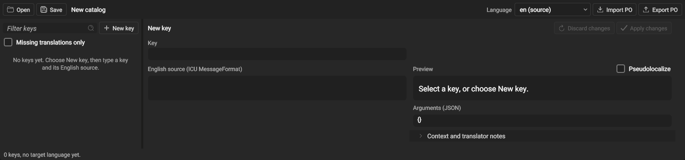

*An empty catalog. The list says what to do first.*

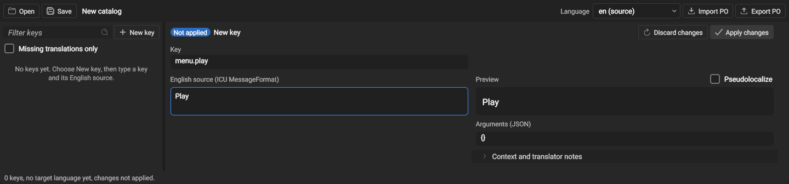

*Choose **New key**, then type a key and its English source. The preview follows the typing; **Not applied** marks the draft until **Apply changes**.*

### Add a language

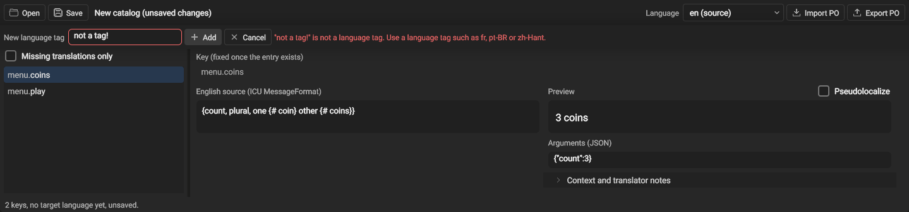

*Choosing **+ Add language…** at the end of the language list opens a field over the panel. An invalid tag is refused beside the field, with the accepted form.*

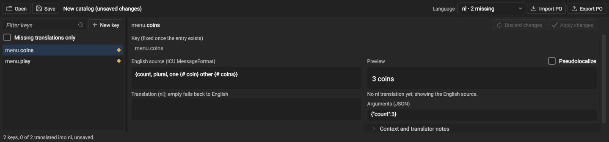

*After adding `nl`, every key shows a missing dot, the list reads **nl · 2 missing**, and the preview says it is showing the English source.*

### Translate with a live preview

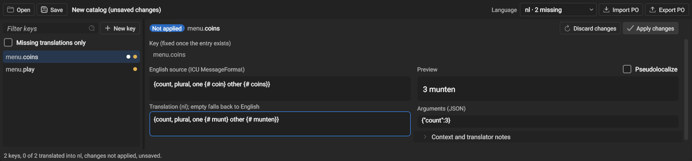

*The preview formats the translation with the arguments in **Arguments (JSON)**.*

### Apply

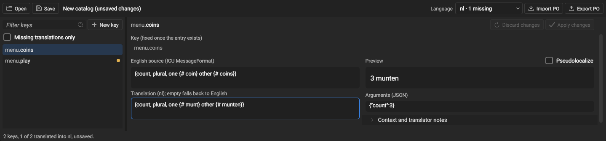

*Applied: the dot leaves the row and the status line counts the translation.*

### Mistakes are named where they are

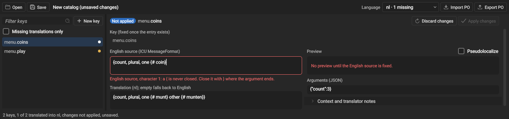

*The field gets an error edge and the message names the character and the fix. The preview says which field to fix, and Apply is disabled.*

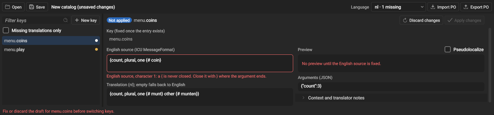

*Switching key or language with an invalid draft is refused, and the status line says why, until the draft is fixed or discarded.*

### Check the fit with pseudolocalization

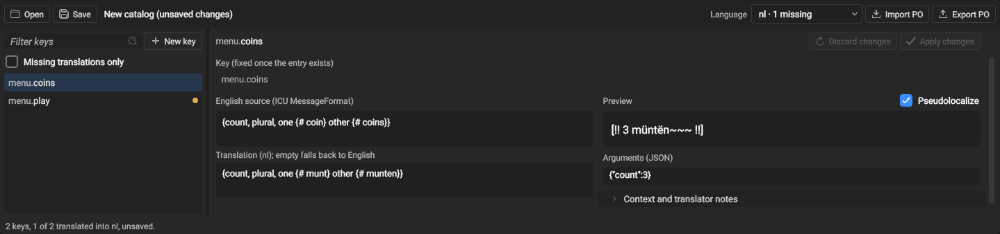

*Accents, about one third of padding and boundary markers, in the preview only.*

### Find keys

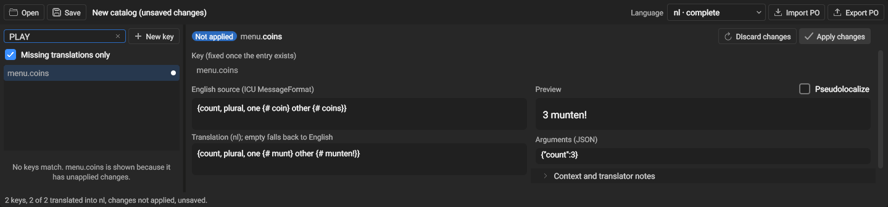

*The filter matches as you type, and **Missing translations only** narrows the list to untranslated keys. Here nothing matches; `menu.coins` stays listed because it has unapplied changes, and the hint says so.*

### Context and translator notes

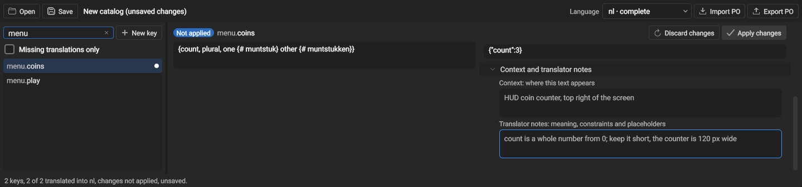

*The entry scrolled down to the notes. Context and notes sit in a section like the Inspector's, collapsed until opened, and are exported to PO as extracted comments.*

### A narrow dock

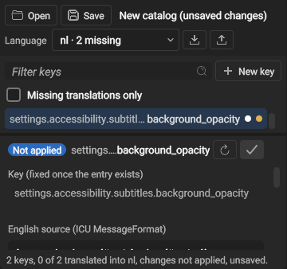

*Narrower than the two panes need side by side, the list sits above the entry; below 400 px, Discard, Apply and the PO buttons show their icons, with the labels as tooltips.*

### Limitations

- Japanese, Chinese, Korean and Arabic text cannot be typed or previewed in the editor yet: the editor's fonts have no glyphs for them. Right-to-left ICU text is laid out in the wrong direction in the fields.
- Apply cannot be undone with the undo shortcut yet.

## Catalog files

A UTF-8 JSON file contains language tables with stable message keys. English (`en`) is the source and the final fallback. A missing translation falls back per key, while an empty translation intentionally displays nothing.

```json title="A catalog with English and Dutch"
{
  "en": {"menu.play": "Play", "coins": "{count, plural, one {# coin} other {# coins}}"},
  "nl": {"menu.play": "Spelen", "coins": "{count, plural, one {# munt} other {# munten}}"}
}
```

All messages compile at load time. Malformed ICU patterns, invalid UTF-8, duplicate JSON members, duplicate normalized locales and mismatched translation placeholders fail the entire replacement and keep the working catalog. Errors identify the message where available. Translations must keep every argument name, including nested branches. Untranslated keys may be omitted.

## Messages and fallback

Use complete ICU messages so translators can reorder words and choose plural or select branches. Named arguments accept UTF-8 strings, signed 64-bit integers and doubles. Supply every argument the message declares, including those in conditional branches. Missing arguments or formatting failures return the authored fallback, with an optional diagnostic. Literal braces use ICU quoting. See the [ICU message guide](https://unicode-org.github.io/icu/userguide/format_parse/messages/).

Locale selection accepts BCP-47 tags and legacy underscore separators. ICU normalizes tags and derives parent locales: for example `nl-NL` falls back to `nl`, then `en`. Unicode locale extensions do not create separate translation tables. Invalid tags do not change state. Formatting uses the language of the selected translation, including when it falls back to English.

## Load a catalog asset

Catalog documents use the `.localization` extension and register as Localization assets. Load one through the asset pipeline, then call `LocalizationAsset::CreateCatalog(error)` on the loaded asset. This creates independent locale state for a UI context. A failed asset load keeps the last valid document. Existing contexts stay snapshots until the host replaces their catalog; unloading the source asset does not invalidate them.

### Load from C++

```cpp title="Load a packaged catalog from a stream"
std::ifstream stream(packagedCatalogPath); // a path inside the staged application or project
std::string error;
auto catalog = std::make_shared<GameEngine::Localization::LocalizationCatalog>();
if (!catalog->Load(stream, error)) { /* display error; keep the previous catalog */ }
```

The JSON format above can be written by a tool or loaded from any UTF-8 input stream. `Load` validates and replaces the catalog atomically. Keep ownership of a catalog to change its locale or reload it later.

## Assign the catalog once to the UI manager

```cpp title="Give the UI manager its catalog and choose a language"
// ui is the application's initialized GameEngine::UIManager.
ui.SetLocalizationCatalog(catalog);
if (!catalog->SetLocale("nl-NL", error)) { /* display error */ }
```

The manager owns the catalog and its single change subscription. Locale changes, successful catalog reloads and catalog replacement refresh all its bound labels and invalidate their text layout. Labels read the catalog from their owner; callers do not pass catalogs to individual controls. Moving a label between managers uses the new owner's catalog. Clearing the manager's catalog restores the literal fallback text. Update the catalog and the UI on the owning UI thread.

## Bind strings in UXML

```xml title="Labels bound to catalog keys"
<Label id="play" localization-key="menu.play" text="Play" />
<Label id="coins" localization-key="coins" text="Coins" />
```

`localization-key` names the catalog entry. `text` is a literal fallback, used when no catalog is assigned, no entry matches after language fallback, or formatting fails. It is not a translation entry and is not read as an ICU pattern. An intentionally empty translation displays nothing. Removing the key during a UXML reload removes the binding. UXML and C++ use the same binding state.

### Bind strings from C++

```cpp title="Bind labels to catalog keys in code"
auto play = std::make_unique<GameEngine::Label>();
play->BindLocalization(GameEngine::HashStringId("menu.play"), "Play");
ui.GetRootElement()->AddChild(std::move(play)); // inherits this manager's catalog

auto coins = std::make_unique<GameEngine::Label>();
GameEngine::Label* coinLabel = coins.get(); // valid while the UI tree owns the label
coinLabel->BindLocalization(GameEngine::HashStringId("coins"), "Coins",
                            {{"count", int64_t{1}}});
ui.GetRootElement()->AddChild(std::move(coins));
```

Bind before or after attaching the label. A detached label displays its literal fallback. `ClearLocalization` removes a binding and keeps the text on screen. `SetText` shows literal text and removes the binding, so a later language change does not overwrite it.

## Update dynamic message arguments

Arguments supply values for named ICU placeholders. For the pattern `{count, plural, one {# coin} other {# coins}}`, pass a numeric `count`; ICU selects the plural branch and formats the number. String arguments can fill names or select branches. Supply every declared argument, including those in conditional branches.

```cpp title="Update a label's arguments when the value changes"
// In the application's coin-count change handler:
coinLabel->SetLocalizationArguments({{"count", int64_t{22}}});
```

This replaces the label's stored argument values and refreshes its text at once. Call it when the application value changes, not every frame; the binding does not watch game variables. Changing the language or reloading the catalog reuses these values. UXML labels use the same method for dynamic values after finding the label by id.

## Fonts and Unicode text

Translation and font selection are separate. Choose a `font-family` in CSS and supply the font through the shared font resolver. A custom resolver can supply ordered packaged fallback paths in `UIManager::FontResolveResult::FallbackFonts`. The host chooses their order and any locale-specific primary font. There is no directory scanning or file-name-based language policy. Standalone text users can call `FontAtlas::SetFallbackFonts` before loading the primary face.

A game made in the editor resolves `font-family` names to the project's font assets and supplies no fallback faces. To show Japanese, Arabic or another script the default font lacks, import a font that covers it into the project (for example Noto Sans JP or Noto Sans Arabic, with its license) and set `font-family` to that font's family on the elements that show the language, for example with a class the game sets on its root while that language is active. Text a face cannot draw renders nothing, and the log names the font and the script once.

`TextShaper` owns Unicode segmentation, HarfBuzz shaping and cluster-level fallback selection. `FontAtlas` stores the resulting glyph resources and caches measurements. Its language setter forwards a shaping hint and invalidates measurement caches only when the hint changes; it does not choose fonts or rebuild glyph textures. HarfBuzz needs a language hint because the same text and font can use different language-specific OpenType substitutions. `und` is the BCP-47 tag for "undetermined", used when no language preference is known.

Text uses ICU bidirectional and grapheme runs with HarfBuzz shaping, with an explicitly supplied primary font and ordered fallback files. Whole clusters select a covering face, so combining sequences stay together. Selection rectangles follow visual clusters, including disjoint ranges in mixed-direction text. Arrow keys in text fields and vertical hit testing in multiline text use visual caret stops on shaped-cluster boundaries. Backspace and Delete use ICU extended grapheme boundaries, so combining marks, joined emoji and flag sequences are edited as units. Word selection and word-wise movement use ICU dictionary boundaries, including Thai and CJK, and keep the editor's dot and colon behavior for identifiers. Wrapping uses ICU line-break opportunities over the whole paragraph; style boundaries do not introduce word breaks, and shaped clusters are never split. Styled spans are ordered by the line's bidi runs and keep the line as HarfBuzz joining context. Mixed font sizes share a baseline.

Locale resolution keeps exact region and variant matches, then uses ICU likely-subtag script matching before a generic language fallback. For example, `zh-TW` can resolve a `zh-Hant` table. It does not select an unrelated default region.

## Text warmup

After styles resolve, call `UIManager::PrepareTextSubtree` on the owning UI thread before revealing a screen. It resolves styles beneath hidden containers without revealing them, visits hidden text too, shapes fallback glyphs and registers curve, band and color atlas resources. **Pending** means preferred font requests or initial style and render setup are still in progress; **Ready** means the text resources are prepared; **Failed** reports a missing font or a resource allocation failure. Warm again after changing text, locale, font style or display scale.

## Language preference

`SetSystemLocale` initializes the catalog from ICU's platform locale. `RestoreLocale` reads a bounded language tag from a host-owned stream and keeps the current locale on invalid input. `WriteLocale` saves the canonical selected tag. The host chooses its writable application data path; catalogs never resolve runtime paths into the source repository. UIWindowDemo uses its application data directory and saves language changes made with F6.

## Build and packaged example

CMake finds the ICU uc, i18n and data components from the vcpkg manifest. ICU headers stay private to the implementation. ICU data must accompany shared-library builds; the standard runtime dependency staging handles linked libraries. ICU is a vcpkg port; its license notice ships from the port's copyright file like every other vcpkg dependency.

UIWindowDemo loads `Localization/menu.localization` beside the executable, independent of the working directory. Its title and count use one catalog. Press F6 to cycle English, Dutch, Polish, Japanese, Korean, Simplified Chinese, Traditional Chinese, Arabic, Hebrew, Hindi and Thai; F7 adds a coin to exercise plural changes. The catalog, layout, default font, compiled shaders and notices are staged by CMake. Supply project fonts for scripts the default font lacks before using those locales. The registered `LocalizationTests` also load the staged catalog. The example is a small integration fixture, not a complete translated game.

## Font packaging

The engine does not ship an all-language font pack. Projects package and license fonts covering the scripts they support. The Text tests stage a small set of Noto fixtures only for regression testing; these do not enter Editor or Player distributions. Fixture provenance and OFL notices live with the test fonts. Test coverage is not a claim of complete language coverage.

## Browser file exchange

In the browser editor, catalogs and PO files are imported through the shared browser picker. Save and Export PO start browser downloads rather than overwriting the original host file; complete the download in the browser. Imported temporary files are released after reading.

## Changelog

- 2026-10-23: Missing report counts plurals without the language's categories; language names in the language list; per-key preview arguments; context and notes under the source; `ClearLocalization`, and `SetText` removes a binding; the panel opens beside the Scene View; font guidance for games made in the editor.
- 2026-10-13: Using the Localization panel: screenshots of the workflow.
- 2026-10-13: Converted from `docs/localization.html`. The Localization panel opens from the panel menus (Window and the toolbar's panel list) with its own icon, instead of Tools > Localization; the entry fields are a draft with Apply and Discard.
- 2026-10-12: Localization panel: key list with missing dots beside the entry editor, live preview of the draft.
- 2026-09-25: Localization is bundled into the Engine library as an engine module; the Player stages only its 2 default faces; the Text test fixtures are subset fonts.
- 2026-09-21: Initial guide: ICU catalogs and assets, UIManager-owned catalog with UXML and C++ label bindings, TextShaper-owned shaping and fallback, editor authoring panel with PO exchange, browser file exchange.
